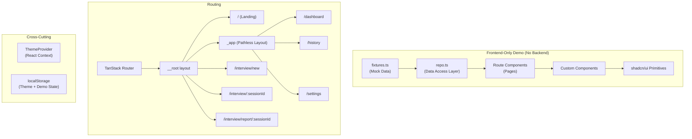
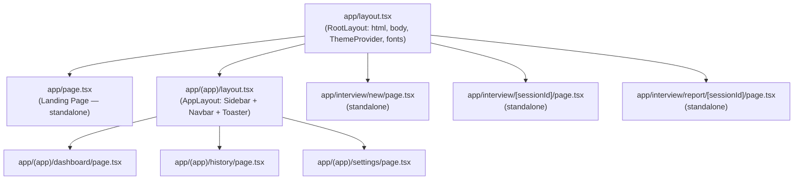

# MockMate: TanStack Start → Next.js App Router Migration Report

> [!IMPORTANT]
> This is an **analysis-only** document. No files have been modified. Implementation awaits your explicit approval.

---

## 1. Current Architecture Overview

### Framework Stack

| Layer | Technology | Version |
|-------|-----------|---------|
| **Meta-framework** | TanStack Start | `^1.112.0` |
| **Router** | TanStack Router (file-based) | `^1.112.0` |
| **Build / Dev server** | Vinxi (wraps Vite) | `^0.5.3` |
| **UI library** | React | `^19.0.0` |
| **Styling** | Tailwind CSS v3 + `tailwindcss-animate` | `^3.4.17` |
| **Component system** | shadcn/ui (40+ Radix primitives) | N/A (vendored) |
| **Charts** | Recharts | `^2.15.0` |
| **Forms** | react-hook-form + zod + @hookform/resolvers | `^7.54.2` / `^3.24.1` |
| **Icons** | lucide-react | `^0.462.0` |
| **Language** | TypeScript (strict) | `^5.7.3` |

### Architecture Pattern



### Key Architectural Characteristics

- **Frontend-only demo** — zero backend, no auth, no API calls, no database
- **All data from fixtures** — [`fixtures.ts`](file:///Users/shubham/Projects/MockMate/src/data/fixtures.ts) → [`repo.ts`](file:///Users/shubham/Projects/MockMate/src/lib/repo.ts) (synchronous reads)
- **Theme system** — [`theme.tsx`](file:///Users/shubham/Projects/MockMate/src/lib/theme.tsx) React Context with `localStorage` persistence under `interview-coach-theme`
- **No server functions** — no `createServerFn`, no SSR data loading, no API routes
- **Single env variable** — `VITE_MOCK_MODE=true` (referenced but not functionally used)

---

## 2. Complete Route Inventory

### Current TanStack Routes → Proposed Next.js Routes

| # | Current File | URL Path | Layout | Next.js File |
|---|-------------|----------|--------|-------------|
| 1 | [`__root.tsx`](file:///Users/shubham/Projects/MockMate/src/routes/__root.tsx) | — (root shell) | Root | `app/layout.tsx` |
| 2 | [`_app.tsx`](file:///Users/shubham/Projects/MockMate/src/routes/_app.tsx) | — (pathless) | App shell | `app/(app)/layout.tsx` |
| 3 | [`_app/dashboard.tsx`](file:///Users/shubham/Projects/MockMate/src/routes/_app/dashboard.tsx) | `/dashboard` | App | `app/(app)/dashboard/page.tsx` |
| 4 | [`_app/history.tsx`](file:///Users/shubham/Projects/MockMate/src/routes/_app/history.tsx) | `/history` | App | `app/(app)/history/page.tsx` |
| 5 | [`_app/settings.tsx`](file:///Users/shubham/Projects/MockMate/src/routes/_app/settings.tsx) | `/settings` | App | `app/(app)/settings/page.tsx` |
| 6 | [`index.tsx`](file:///Users/shubham/Projects/MockMate/src/routes/index.tsx) | `/` | Root only | `app/page.tsx` |
| 7 | [`interview/new.tsx`](file:///Users/shubham/Projects/MockMate/src/routes/interview/new.tsx) | `/interview/new` | Root only | `app/interview/new/page.tsx` |
| 8 | [`interview/$sessionId.tsx`](file:///Users/shubham/Projects/MockMate/src/routes/interview/$sessionId.tsx) | `/interview/:id` | Root only | `app/interview/[sessionId]/page.tsx` |
| 9 | [`interview/report/$sessionId.tsx`](file:///Users/shubham/Projects/MockMate/src/routes/interview/report/$sessionId.tsx) | `/interview/report/:id` | Root only | `app/interview/report/[sessionId]/page.tsx` |

### Layout Nesting (Next.js)



> [!NOTE]
> TanStack's pathless `_app` layout maps directly to Next.js **route groups** — `(app)` in the folder name. The parentheses prevent the segment from appearing in the URL, identical behavior to the underscore prefix in TanStack.

---

## 3. Components That Can Be Reused Without Modification

These files have **zero TanStack dependencies** and use only React, Radix, Tailwind, and standard browser APIs:

### shadcn/ui Primitives (40+ files) — All Reusable As-Is

All files under [`src/components/ui/`](file:///Users/shubham/Projects/MockMate/src/components/ui/):

`accordion` · `alert-dialog` · `alert` · `aspect-ratio` · `avatar` · `badge` · `breadcrumb` · `button` · `calendar` · `card` · `carousel` · `chart` · `checkbox` · `collapsible` · `command` · `context-menu` · `dialog` · `drawer` · `dropdown-menu` · `form` · `hover-card` · `input-otp` · `input` · `label` · `menubar` · `navigation-menu` · `pagination` · `popover` · `progress` · `radio-group` · `resizable` · `scroll-area` · `select` · `separator` · `sheet` · `sidebar` · `skeleton` · `slider` · `sonner` · `switch` · `table` · `tabs` · `textarea` · `toast` · `toaster` · `toggle-group` · `toggle` · `tooltip` · `use-toast`

### Custom Components — Reusable As-Is

| File | Reason |
|------|--------|
| [`InterviewControls.tsx`](file:///Users/shubham/Projects/MockMate/src/components/InterviewControls.tsx) | Pure React (useState, useEffect), no router imports |
| [`InterviewFeedback.tsx`](file:///Users/shubham/Projects/MockMate/src/components/InterviewFeedback.tsx) | Pure presentational component |
| [`MetricCard.tsx`](file:///Users/shubham/Projects/MockMate/src/components/MetricCard.tsx) | Pure presentational component |
| [`PerformanceChart.tsx`](file:///Users/shubham/Projects/MockMate/src/components/PerformanceChart.tsx) | Uses Recharts only (needs `'use client'` directive) |
| [`ScoreCircle.tsx`](file:///Users/shubham/Projects/MockMate/src/components/ScoreCircle.tsx) | Pure SVG component |
| [`ThemeToggle.tsx`](file:///Users/shubham/Projects/MockMate/src/components/ThemeToggle.tsx) | Uses custom `useTheme` — no TanStack imports |

### Library / Data Files — Reusable As-Is

| File | Notes |
|------|-------|
| [`lib/utils.ts`](file:///Users/shubham/Projects/MockMate/src/lib/utils.ts) | `cn()` helper — framework-agnostic |
| [`lib/theme.tsx`](file:///Users/shubham/Projects/MockMate/src/lib/theme.tsx) | React Context — framework-agnostic (needs `'use client'`) |
| [`lib/repo.ts`](file:///Users/shubham/Projects/MockMate/src/lib/repo.ts) | Pure data access — framework-agnostic |
| [`data/fixtures.ts`](file:///Users/shubham/Projects/MockMate/src/data/fixtures.ts) | Static mock data — framework-agnostic |

**Total: ~50 files reusable without modification** (may need `'use client'` directive only)

---

## 4. Components Requiring Modification

These components import TanStack-specific APIs that must be swapped to Next.js equivalents:

| Component | TanStack Imports | Required Changes |
|-----------|-----------------|-----------------|
| [`AppNavbar.tsx`](file:///Users/shubham/Projects/MockMate/src/components/AppNavbar.tsx) | `useLocation` | Replace with `usePathname()` from `next/navigation`; add `'use client'` |
| [`AppSidebar.tsx`](file:///Users/shubham/Projects/MockMate/src/components/AppSidebar.tsx) | `Link`, `useLocation` | Replace `Link` → `next/link`; `useLocation` → `usePathname()`; add `'use client'` |
| [`InterviewAnalysisReport.tsx`](file:///Users/shubham/Projects/MockMate/src/components/InterviewAnalysisReport.tsx) | `Link` | Replace with `next/link` Link; add `'use client'` (uses interactive tabs) |
| [`InterviewConfig.tsx`](file:///Users/shubham/Projects/MockMate/src/components/InterviewConfig.tsx) | `Link`, `useNavigate` | Replace `Link` → `next/link`; `useNavigate` → `useRouter().push()`; add `'use client'` |
| [`InterviewSimulator.tsx`](file:///Users/shubham/Projects/MockMate/src/components/InterviewSimulator.tsx) | `Link`, `useNavigate` | Replace `Link` → `next/link`; `useNavigate` → `useRouter().push()`; add `'use client'` |

### Migration Map for TanStack → Next.js APIs

| TanStack API | Next.js Equivalent | Import From |
|-------------|-------------------|------------|
| `<Link to="/path">` | `<Link href="/path">` | `next/link` |
| `<Link to="/path" params={{ id }}>` | `<Link href={`/path/${id}`}>` | `next/link` |
| `useNavigate()` → `navigate({ to, params })` | `useRouter().push(url)` | `next/navigation` |
| `useLocation().pathname` | `usePathname()` | `next/navigation` |
| `Route.useParams()` | `useParams()` or page `params` prop | `next/navigation` |
| `createFileRoute(path)` | File-based routing (automatic) | N/A |
| `createRootRoute()` | `app/layout.tsx` | N/A |
| `<Outlet />` | `{children}` prop in layouts | N/A |
| `HeadContent` + `head()` | `export const metadata` or `generateMetadata()` | `next` |
| `<Scripts />` | Automatic in Next.js | N/A |
| CSS `?url` import | Standard CSS import in layout | N/A |

---

## 5. Components Requiring Complete Rewriting

**None.** No components need complete rewriting. Every component can be migrated through targeted import swaps and minor API adjustments. The UI, logic, and styling remain identical.

---

## 6. TanStack-Specific Dependencies That Must Be Replaced

### Packages to Remove

| Package | Why |
|---------|-----|
| `@tanstack/react-router` | Replaced by Next.js file-based routing |
| `@tanstack/react-start` | Replaced by Next.js framework |
| `vinxi` | Replaced by Next.js build system |
| `vite-tsconfig-paths` | Next.js handles path aliases natively via `tsconfig.json` |

### Packages to Add

| Package | Why |
|---------|-----|
| `next` | Next.js framework |
| `@next/env` | Environment variable loading (built into Next.js) |

### Packages to Keep (All Compatible)

All Radix UI packages, `react`, `react-dom`, `recharts`, `react-hook-form`, `zod`, `@hookform/resolvers`, `lucide-react`, `class-variance-authority`, `clsx`, `tailwind-merge`, `tailwindcss-animate`, `sonner`, `vaul`, `cmdk`, `date-fns`, `embla-carousel-react`, `input-otp`, `react-day-picker`, `react-resizable-panels`, `tailwindcss`, `postcss`, `autoprefixer`, `typescript`, `@tailwindcss/typography`.

---

## 7. Proposed Next.js App Router Directory Structure

```
MockMate/
├── app/
│   ├── layout.tsx                              # Root layout (html, body, ThemeProvider, fonts, metadata)
│   ├── page.tsx                                # Landing page (/)
│   ├── globals.css                             # Design tokens (renamed from styles.css)
│   ├── (app)/
│   │   ├── layout.tsx                          # App shell layout (Sidebar, Navbar, Toaster)
│   │   ├── dashboard/
│   │   │   └── page.tsx                        # Dashboard (/dashboard)
│   │   ├── history/
│   │   │   └── page.tsx                        # History (/history)
│   │   └── settings/
│   │       └── page.tsx                        # Settings (/settings)
│   └── interview/
│       ├── new/
│       │   └── page.tsx                        # New interview config (/interview/new)
│       ├── [sessionId]/
│       │   └── page.tsx                        # Interview session (/interview/:sessionId)
│       └── report/
│           └── [sessionId]/
│               └── page.tsx                    # Interview report (/interview/report/:sessionId)
├── components/                                 # Moved from src/components/
│   ├── AppNavbar.tsx                           # Modified (usePathname)
│   ├── AppSidebar.tsx                          # Modified (Link, usePathname)
│   ├── InterviewAnalysisReport.tsx             # Modified (Link)
│   ├── InterviewConfig.tsx                     # Modified (Link, useRouter)
│   ├── InterviewControls.tsx                   # As-is
│   ├── InterviewFeedback.tsx                   # As-is
│   ├── InterviewSimulator.tsx                  # Modified (Link, useRouter)
│   ├── MetricCard.tsx                          # As-is
│   ├── PerformanceChart.tsx                    # As-is (+ 'use client')
│   ├── ScoreCircle.tsx                         # As-is
│   ├── ThemeToggle.tsx                         # As-is
│   └── ui/                                     # All 40+ shadcn/ui files — as-is
├── lib/
│   ├── utils.ts                                # As-is
│   ├── theme.tsx                               # As-is (+ 'use client')
│   └── repo.ts                                 # As-is
├── data/
│   └── fixtures.ts                             # As-is
├── next.config.ts                              # New — Next.js configuration
├── tailwind.config.ts                          # Kept — content paths updated
├── postcss.config.mjs                          # Kept — as-is
├── tsconfig.json                               # Updated — Next.js conventions
├── package.json                                # Updated — deps changed
└── .env.local                                  # Renamed from .env (NEXT_PUBLIC_ prefix)
```

> [!TIP]
> Next.js App Router uses a top-level `app/` directory for routes and conventionally places shared code in `components/`, `lib/`, and `data/` at the project root (outside `app/`). The `src/` prefix is optional — Next.js supports both layouts. Moving out of `src/` is recommended for cleaner separation of route files from reusable modules.

---

## 8. Dependency Installation & Removal Plan

### Step 1: Install Next.js

```bash
pnpm add next
```

### Step 2: Remove TanStack & Vinxi

```bash
pnpm remove @tanstack/react-router @tanstack/react-start vinxi vite-tsconfig-paths
```

### Step 3: Update `package.json` scripts

```json
{
  "scripts": {
    "dev": "next dev",
    "build": "next build",
    "start": "next start",
    "lint": "next lint"
  }
}
```

### Step 4: Environment Variable

Rename `.env` → `.env.local` and update:

```diff
- VITE_MOCK_MODE=true
+ NEXT_PUBLIC_MOCK_MODE=true
```

### Step 5: Delete TanStack-specific files

- `app.config.ts` (TanStack Start config)
- `vite.config.ts` (Vite config)
- `src/router.tsx` (TanStack router factory)
- `src/routeTree.gen.ts` (auto-generated route tree)
- `index.html` (Vite entry — Next.js generates its own)

### Step 6: Create `next.config.ts`

```ts
import type { NextConfig } from 'next';

const nextConfig: NextConfig = {
  // No special config needed for this demo app
};

export default nextConfig;
```

### Step 7: Update `tsconfig.json`

```json
{
  "compilerOptions": {
    "target": "ES2017",
    "lib": ["dom", "dom.iterable", "esnext"],
    "allowJs": true,
    "skipLibCheck": true,
    "strict": true,
    "noEmit": true,
    "esModuleInterop": true,
    "module": "esnext",
    "moduleResolution": "bundler",
    "resolveJsonModule": true,
    "isolatedModules": true,
    "jsx": "preserve",
    "incremental": true,
    "plugins": [{ "name": "next" }],
    "paths": {
      "@/*": ["./*"]
    }
  },
  "include": ["next-env.d.ts", "**/*.ts", "**/*.tsx", ".next/types/**/*.ts"],
  "exclude": ["node_modules"]
}
```

> [!WARNING]
> The `@/*` path alias changes from `./src/*` to `./*` since files move to the project root. All existing `@/components/...`, `@/lib/...`, and `@/data/...` imports remain valid without changes.

### Step 8: Update `tailwind.config.ts` content paths

```diff
  content: [
-   "./src/**/*.{ts,tsx}",
+   "./app/**/*.{ts,tsx}",
+   "./components/**/*.{ts,tsx}",
+   "./lib/**/*.{ts,tsx}",
  ],
```

---

## 9. Potential Migration Risks & Compatibility Issues

### Risk Assessment Matrix

| # | Risk | Severity | Likelihood | Mitigation |
|---|------|----------|------------|------------|
| 1 | **React 19 + Next.js compatibility** | 🟡 Medium | Low | Next.js 15+ fully supports React 19. Pin to Next.js ≥ 15. |
| 2 | **`'use client'` boundary mistakes** | 🟡 Medium | Medium | Any component using `useState`, `useEffect`, `useContext`, browser APIs, or event handlers must have `'use client'`. Create a checklist (provided in Phase 2 below). |
| 3 | **`useLocation` → `usePathname` behavioral difference** | 🟢 Low | Low | TanStack's `useLocation()` returns an object with `.pathname`; Next.js `usePathname()` returns the string directly. Simple refactor. |
| 4 | **Dynamic route parameter syntax** | 🟢 Low | Low | TanStack uses `$param`, Next.js uses `[param]`. Folder rename only. |
| 5 | **`Link` prop differences** | 🟢 Low | Medium | TanStack: `<Link to="/path" params={{}}>`. Next.js: `<Link href="/path">`. The `params` pattern must be replaced with string interpolation. |
| 6 | **Theme flash on SSR** | 🟡 Medium | Medium | The existing inline `<script>` for theme detection must be preserved in the root `layout.tsx`. Next.js `<Script strategy="beforeInteractive">` or `dangerouslySetInnerHTML` in the `<head>` achieves this. |
| 7 | **CSS `?url` import** | 🟢 Low | Low | TanStack/Vite uses `import appCss from '@/styles.css?url'`. Next.js uses standard `import './globals.css'` in the root layout. |
| 8 | **Recharts SSR** | 🟡 Medium | Medium | Recharts components are client-only. `PerformanceChart` needs `'use client'`. If rendered in a Server Component parent, wrap with dynamic import `next/dynamic` with `{ ssr: false }`. |
| 9 | **Sidebar state (SidebarProvider)** | 🟢 Low | Low | The shadcn/ui `SidebarProvider` uses React context — needs `'use client'` on the app layout. |
| 10 | **Lovable git history** | 🟡 Medium | Medium | Per AGENTS.md, avoid force-pushing or rewriting history. All migration work should be committed incrementally on the connected branch. |
| 11 | **Font loading** | 🟢 Low | Low | Currently loads Inter via Google Fonts `<link>` in CSS. Migrate to `next/font/google` for performance (self-hosted, zero layout shift). |
| 12 | **Build output differences** | 🟢 Low | Low | Vinxi/Vite → Next.js build. `.output/` → `.next/`. Update `.gitignore`. |

### No-Risk Items ✅

- **No backend/API routes** to migrate
- **No authentication** to reconfigure
- **No database connections** to rewire
- **No server functions** (`createServerFn`) to convert
- **No middleware** to port
- **No SSR data fetching** (loaders, etc.) — all data is synchronous from fixtures

---

## 10. Phased Migration Plan

### Phase 0: Preparation (est. 15 min)

| Step | Action | Validation |
|------|--------|-----------|
| 0.1 | Create a new git branch `feat/nextjs-migration` | `git checkout -b feat/nextjs-migration` |
| 0.2 | Take a screenshot / recording of every page in the current app for visual regression comparison | Manual — capture `/`, `/dashboard`, `/history`, `/settings`, `/interview/new`, `/interview/session-1`, `/interview/report/session-1` (both light and dark modes) |
| 0.3 | Document the current `pnpm dev` behavior — port, startup time | Note for comparison |

---

### Phase 1: Scaffold Next.js & Migrate Config (est. 20 min)

| Step | Action | Validation |
|------|--------|-----------|
| 1.1 | Install `next`, remove `@tanstack/react-router`, `@tanstack/react-start`, `vinxi`, `vite-tsconfig-paths` | `pnpm install` succeeds |
| 1.2 | Update `package.json` scripts to `next dev` / `next build` / `next start` | Scripts updated |
| 1.3 | Create `next.config.ts` | File exists |
| 1.4 | Update `tsconfig.json` to Next.js conventions | TypeScript compiles |
| 1.5 | Rename `.env` → `.env.local`, prefix vars with `NEXT_PUBLIC_` | Env loaded |
| 1.6 | Update `tailwind.config.ts` content paths | Tailwind processes new paths |
| 1.7 | Delete `app.config.ts`, `vite.config.ts`, `index.html`, `src/router.tsx`, `src/routeTree.gen.ts` | No orphaned config |
| 1.8 | Update `.gitignore` — add `.next/`, remove `.output/` | Clean git status |
| **✓** | `pnpm next dev` starts without errors (may show missing pages) | Dev server boots |

---

### Phase 2: Create Route Structure & Root Layout (est. 30 min)

| Step | Action | Validation |
|------|--------|-----------|
| 2.1 | Create `app/layout.tsx` — port from `__root.tsx`: `<html>`, `<body>`, `ThemeProvider`, theme inline script, metadata, CSS import | Root layout renders |
| 2.2 | Move `src/styles.css` → `app/globals.css` and import in root layout | Styles applied |
| 2.3 | Create `app/(app)/layout.tsx` — port from `_app.tsx`: `SidebarProvider`, `AppSidebar`, `AppNavbar`, `Toaster`, `{children}` | App shell renders |
| 2.4 | Create empty `page.tsx` for each route (9 total) as placeholders | All routes accessible |
| **✓** | Navigate to every URL — layouts render correctly | Visual check |

---

### Phase 3: Move Reusable Code (est. 15 min)

| Step | Action | Validation |
|------|--------|-----------|
| 3.1 | Move `src/components/ui/*` → `components/ui/*` | All imports resolve |
| 3.2 | Move `src/lib/*` → `lib/*` | Imports resolve |
| 3.3 | Move `src/data/*` → `data/*` | Imports resolve |
| 3.4 | Move `src/components/InterviewControls.tsx`, `InterviewFeedback.tsx`, `MetricCard.tsx`, `PerformanceChart.tsx`, `ScoreCircle.tsx`, `ThemeToggle.tsx` → `components/` | No modifications needed |
| 3.5 | Add `'use client'` directive to all files using hooks, state, context, or browser APIs (see checklist below) | No hydration errors |
| **✓** | `pnpm next build` compiles without errors | Build passes |

#### `'use client'` Directive Checklist

| File | Needs `'use client'` | Reason |
|------|---------------------|--------|
| `lib/theme.tsx` | ✅ Yes | `useState`, `useEffect`, `useContext`, `localStorage` |
| `components/ThemeToggle.tsx` | ✅ Yes | `useTheme()` context |
| `components/PerformanceChart.tsx` | ✅ Yes | Recharts (DOM-dependent) |
| `components/InterviewControls.tsx` | ✅ Yes | `useState`, `useEffect` |
| `components/InterviewFeedback.tsx` | ❌ No | Pure presentational |
| `components/MetricCard.tsx` | ❌ No | Pure presentational |
| `components/ScoreCircle.tsx` | ❌ No | Pure presentational (SVG) |
| `components/ui/sidebar.tsx` | ✅ Yes | Uses context, state |
| `components/ui/toaster.tsx` | ✅ Yes | Uses `useToast` hook |
| `components/ui/toast.tsx` | ✅ Yes | Uses state |
| `components/ui/use-toast.ts` | ✅ Yes | Uses `useState` |
| Most other `ui/*` | ✅ Yes | Most use Radix (client-side) |

> [!NOTE]
> shadcn/ui components from `components/ui/` generally all need `'use client'` since they use Radix UI primitives which are inherently client-side. The safest approach is to add the directive to every `ui/*` file that imports from `@radix-ui/*`.

---

### Phase 4: Migrate Components with TanStack Imports (est. 30 min)

| Step | Component | Changes |
|------|-----------|---------|
| 4.1 | [`AppNavbar.tsx`](file:///Users/shubham/Projects/MockMate/src/components/AppNavbar.tsx) | `import { useLocation } from '@tanstack/react-router'` → `import { usePathname } from 'next/navigation'`; `location.pathname` → `usePathname()`; add `'use client'` |
| 4.2 | [`AppSidebar.tsx`](file:///Users/shubham/Projects/MockMate/src/components/AppSidebar.tsx) | `Link` → `next/link` (`to` → `href`); `useLocation` → `usePathname()`; add `'use client'` |
| 4.3 | [`InterviewAnalysisReport.tsx`](file:///Users/shubham/Projects/MockMate/src/components/InterviewAnalysisReport.tsx) | `Link` → `next/link` (`to` → `href`); add `'use client'` |
| 4.4 | [`InterviewConfig.tsx`](file:///Users/shubham/Projects/MockMate/src/components/InterviewConfig.tsx) | `Link` → `next/link`; `useNavigate` → `useRouter().push()`; `navigate({ to: '/interview/$sessionId', params: { sessionId } })` → `router.push(`/interview/${sessionId}`)`; add `'use client'` |
| 4.5 | [`InterviewSimulator.tsx`](file:///Users/shubham/Projects/MockMate/src/components/InterviewSimulator.tsx) | Same as 4.4 pattern; add `'use client'` |
| **✓** | Grep for any remaining `@tanstack` imports — must be zero | `grep -r "@tanstack" components/ app/ lib/` returns nothing |

---

### Phase 5: Migrate Page Components (est. 30 min)

| Step | Page | Key Changes |
|------|------|------------|
| 5.1 | `app/page.tsx` (Landing) | Port from `routes/index.tsx`; remove `createFileRoute`; replace `Link` → `next/link`; add `'use client'` or keep as Server Component if no interactivity |
| 5.2 | `app/(app)/dashboard/page.tsx` | Port from `routes/_app/dashboard.tsx`; remove `createFileRoute`; replace `Link`; call `getDashboardStats()` / `getRecentSessions()` |
| 5.3 | `app/(app)/history/page.tsx` | Port from `routes/_app/history.tsx`; remove `createFileRoute`; replace `Link`; add `'use client'` (uses `useState`, `useMemo`) |
| 5.4 | `app/(app)/settings/page.tsx` | Port from `routes/_app/settings.tsx`; remove `createFileRoute`; add `'use client'` (uses `useState`, `useToast`) |
| 5.5 | `app/interview/new/page.tsx` | Simple wrapper rendering `<InterviewConfig />` |
| 5.6 | `app/interview/[sessionId]/page.tsx` | Extract `sessionId` from Next.js `params` prop; render `<InterviewSimulator sessionId={sessionId} />` |
| 5.7 | `app/interview/report/[sessionId]/page.tsx` | Extract `sessionId` from `params`; call `getSessionById()`; render `<InterviewAnalysisReport />` or not-found fallback |
| **✓** | Every page renders identically to the TanStack version | Visual comparison against Phase 0 screenshots |

#### Dynamic Route Parameter Migration Example

**Before (TanStack):**
```tsx
// routes/interview/$sessionId.tsx
export const Route = createFileRoute('/interview/$sessionId')({ component: Page });
function Page() {
  const { sessionId } = Route.useParams();
  return <InterviewSimulator sessionId={sessionId} />;
}
```

**After (Next.js):**
```tsx
// app/interview/[sessionId]/page.tsx
'use client';
import { useParams } from 'next/navigation';
import { InterviewSimulator } from '@/components/InterviewSimulator';

export default function Page() {
  const { sessionId } = useParams<{ sessionId: string }>();
  return <InterviewSimulator sessionId={sessionId} />;
}
```

---

### Phase 6: Font Optimization (est. 10 min)

| Step | Action | Validation |
|------|--------|-----------|
| 6.1 | Replace Google Fonts CSS `@import` in `globals.css` with `next/font/google` in `app/layout.tsx` | Zero layout shift, self-hosted font |
| 6.2 | Apply font className to `<body>` | Visual match confirmed |

**After:**
```tsx
// app/layout.tsx
import { Inter } from 'next/font/google';
const inter = Inter({ subsets: ['latin'] });

// In component:
<body className={inter.className}>
```

---

### Phase 7: Cleanup & Polish (est. 15 min)

| Step | Action | Validation |
|------|--------|-----------|
| 7.1 | Delete `src/` directory entirely (all files moved) | No orphaned files |
| 7.2 | Remove duplicate `postcss.config.js` (keep `postcss.config.mjs`) | Single config |
| 7.3 | Run `pnpm next build` — fix any remaining type errors | Clean build |
| 7.4 | Run `pnpm next dev` — test every route manually | All pages work |
| 7.5 | Test dark/light theme toggle on every page | Theme persists across navigation |
| 7.6 | Test sidebar navigation, active states | Correct active highlighting |
| 7.7 | Test interview flow: `/interview/new` → configure → start → answer → complete → report | Full flow works |
| 7.8 | Test history filtering and search | Filters work correctly |
| 7.9 | Check browser console for errors/warnings | No errors |
| 7.10 | Compare every page against Phase 0 screenshots | Pixel-equivalent |

---

### Phase 8: Commit & Verify (est. 5 min)

| Step | Action | Validation |
|------|--------|-----------|
| 8.1 | `git add -A && git commit -m "feat: migrate from TanStack Start to Next.js App Router"` | Clean commit |
| 8.2 | `git push origin feat/nextjs-migration` | Pushes cleanly (no force push) |
| 8.3 | Verify the branch syncs to Lovable without issues | Lovable shows updated project |

> [!CAUTION]
> Per `AGENTS.md`: Do **not** force push, rebase, amend, or squash commits that are already pushed. This would rewrite history on Lovable's side and the user could lose their project history. Commit incrementally.

---

## Summary Statistics

| Metric | Count |
|--------|-------|
| Total source files | ~75 |
| Route files to create | 9 (2 layouts + 7 pages) |
| Components reusable as-is | ~50 (all `ui/*` + 6 custom) |
| Components needing modification | 5 (import swaps only) |
| Components needing rewrite | 0 |
| Packages to add | 1 (`next`) |
| Packages to remove | 4 (`@tanstack/react-router`, `@tanstack/react-start`, `vinxi`, `vite-tsconfig-paths`) |
| Files to delete | 5 (`app.config.ts`, `vite.config.ts`, `index.html`, `router.tsx`, `routeTree.gen.ts`) |
| Estimated total effort | **~2.5 hours** |
| Risk level | **Low** (frontend-only demo, no backend, no auth) |

---

> **⏸️ Awaiting your approval before implementing any changes.**
