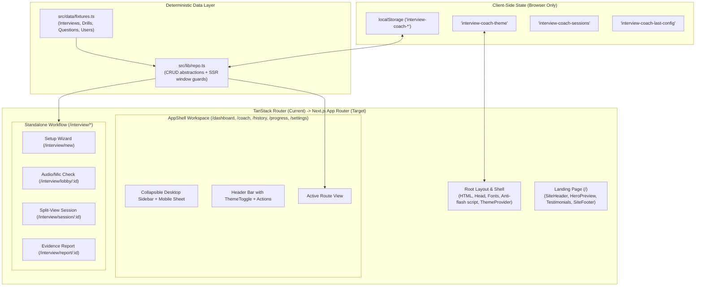
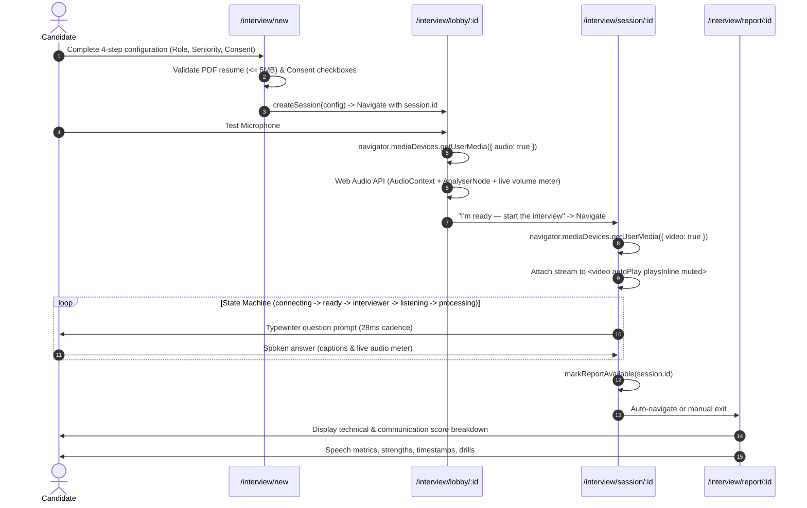
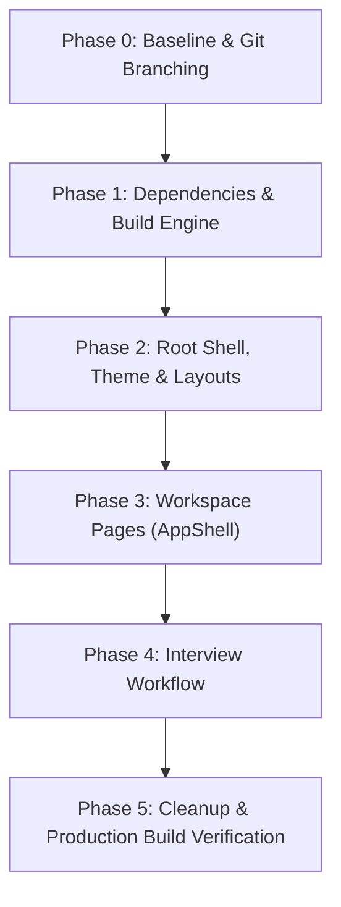

# MockMate: TanStack Start → Next.js App Router Migration Report (Verified)

> [!IMPORTANT]
> **Source of Truth Verification**: This report has been completely updated following an exhaustive, line-by-line inspection of the actual MockMate repository. The initial draft contained critical inaccuracies (e.g. hallucinated components, missing routes, outdated Tailwind v3/Vinxi assumptions). This revised document reflects the exact codebase state.
> 
> **Status**: Analysis and specification only. No application source code or dependencies have been altered. Implementation awaits explicit user approval.

---

## 1. Verified Architecture & Technology Stack

### Current Framework & Dependencies

| Layer | Actual Technology in Repository | Version | Notes / Verified Source |
| :--- | :--- | :--- | :--- |
| **Meta-Framework** | TanStack Start | `1.168.60` | Full-stack meta-framework with SSR entry wrapper |
| **Client Router** | TanStack Router | `1.170.41` | File-based routing with flat dot-notation in `src/routes/` |
| **Data Querying** | TanStack Query | `^5.101.1` | Initialized in router context; wrapped in `QueryClientProvider` |
| **UI Library** | React | `^19.2.0` | React 19 + React DOM 19 |
| **Styling Engine** | Tailwind CSS v4 | `^4.2.1` | Modern v4 engine using `@import "tailwindcss" source(none);` and `@theme inline` |
| **Animation** | `tw-animate-css` | `^1.3.4` | CSS-based keyframe animation for Tailwind v4 |
| **Build & Dev Tool** | Vite | `8.1.5` | Wrapped via `@lovable.dev/vite-tanstack-config@2.26.5` with Nitro target |
| **Component System** | shadcn/ui | `new-york` style | 46 Radix UI primitive wrappers in `src/components/ui/` |
| **Charts** | Recharts | `^2.15.4` | Responsive SVG area and line charts |
| **Forms & Validation**| React Hook Form + Zod | `^7.71.2` / `^3.25.76` | Resolvers via `@hookform/resolvers@^5.2.2` |
| **Icons** | Lucide React | `^0.575.0` | SVG icons throughout app |
| **Language & Engine** | TypeScript | `^5.8.3` | Strict mode with path alias `@/*` $\rightarrow$ `./src/*` |

### Architecture Pattern



---

## 2. Complete Verified Route Inventory

There are **16 TypeScript route definition files** in `src/routes/` (plus 1 documentation `README.md` explaining conventions).

All dynamic routes strictly use the parameter token **`$id`** (not `$sessionId`).

| # | Current TanStack Route File | URL Path | Shell / Layout Pattern | Next.js App Router Target | Functionality & Key Capabilities |
| :--- | :--- | :--- | :--- | :--- | :--- |
| 1 | `src/routes/__root.tsx` | — | Document Root Shell | `src/app/layout.tsx`<br>`src/app/not-found.tsx`<br>`src/app/error.tsx` | HTML shell, anti-flash theme script, Inter font loading, `ThemeProvider`, `QueryClientProvider`, global 404 & error boundary. |
| 2 | `src/routes/index.tsx` | `/` | Standalone + Header/Footer | `src/app/page.tsx` | Landing marketing page with `SiteHeader`, hero interactive preview, feature comparisons, proof points, testimonials, and `SiteFooter`. |
| 3 | `src/routes/_app.tsx` | — (Pathless) | Workspace Wrapper | `src/app/(app)/layout.tsx` | Pathless TanStack route rendering `<Outlet />`. Translates directly to Next.js route group `(app)`. |
| 4 | `src/routes/_app.dashboard.tsx` | `/dashboard` | `AppShell` | `src/app/(app)/dashboard/page.tsx` | Practice overview dashboard: recent sessions, quick stats, score trends chart, recommended next drills. |
| 5 | `src/routes/_app.coach.tsx` | `/coach` | Pathless Coach Layout | *(Merged into `(app)/coach`)* | TanStack layout rendering `<Outlet />` for coach subroutes. |
| 6 | `src/routes/_app.coach.index.tsx` | `/coach` | `AppShell` | `src/app/(app)/coach/page.tsx` | Guided practice coach: skill-focused exercise catalogue, difficulty filtering, hint level selection, direct session launch. |
| 7 | `src/routes/_app.coach.session.$id.tsx` | `/coach/session/:id` | `AppShell` | `src/app/(app)/coach/session/[id]/page.tsx` | Individual practice exercise session: response textarea, real-time word counter, progressive hints, locked model answers, attempt comparisons. |
| 8 | `src/routes/_app.progress.tsx` | `/progress` | `AppShell` | `src/app/(app)/progress/page.tsx` | Longitudinal analytics: technical vs. communication score trajectories over time via Recharts, comparable session groupings. |
| 9 | `src/routes/_app.history.tsx` | `/history` | `AppShell` | `src/app/(app)/history/page.tsx` | Historical interview session table: filterable by role and mode, status badges, links to view analysis reports. |
| 10 | `src/routes/_app.settings.tsx` | `/settings` | Pathless Settings Layout | *(Merged into `(app)/settings`)* | TanStack layout rendering `<Outlet />` for settings subroutes. |
| 11 | `src/routes/_app.settings.index.tsx` | `/settings` | `AppShell` | `src/app/(app)/settings/page.tsx` | Workspace settings: appearance switcher (Light/Dark/System), language preferences, feedback timing controls. |
| 12 | `src/routes/_app.settings.privacy.tsx` | `/settings/privacy` | `AppShell` | `src/app/(app)/settings/privacy/page.tsx` | Privacy & compliance: consent log timeline, audio retention toggles, JSON data export, client-side demo data purge (`localStorage.removeItem`). |
| 13 | `src/routes/interview.new.tsx` | `/interview/new` | Standalone Full-Width | `src/app/interview/new/page.tsx` | 4-step setup wizard (Mode $\rightarrow$ Preferences $\rightarrow$ Consent $\rightarrow$ Review) with PDF resume validation, role/seniority setup, and session creation. |
| 14 | `src/routes/interview.lobby.$id.tsx` | `/interview/lobby/:id` | Standalone Full-Width | `src/app/interview/lobby/[id]/page.tsx` | Pre-interview lobby: live microphone test via Web Audio API + `getUserMedia`, volume level meter, device enumeration, fallback simulated audio. |
| 15 | `src/routes/interview.session.$id.tsx` | `/interview/session/:id` | Standalone Full-Width | `src/app/interview/session/[id]/page.tsx` | Focused live split-view interview: AI interviewer avatar, candidate webcam feed, 6-phase state machine, typewriter effect, live captions, timer. |
| 16 | `src/routes/interview.report.$id.tsx` | `/interview/report/:id` | Standalone Full-Width | `src/app/interview/report/[id]/page.tsx` | Evidence-grounded analysis report: separate technical/communication scores, transcript quotes with timestamps, speech metrics, `<SpeechTimeline />`, print stylesheet. |

---

## 3. Component Inventory & Next.js Reusability

### Category A: 100% Reusable Without Code Modifications (~55 files)
These files contain zero framework-specific imports, zero router bindings, and adhere cleanly to standard React / Web APIs:

1. **All 46 UI Components (`src/components/ui/`)**:
   `accordion`, `alert`, `alert-dialog`, `aspect-ratio`, `avatar`, `badge`, `breadcrumb`, `button`, `calendar`, `card`, `carousel`, `chart`, `checkbox`, `collapsible`, `command`, `context-menu`, `dialog`, `drawer`, `dropdown-menu`, `form`, `hover-card`, `input`, `input-otp`, `label`, `menubar`, `navigation-menu`, `pagination`, `popover`, `progress`, `radio-group`, `resizable`, `scroll-area`, `select`, `separator`, `sheet`, `sidebar`, `skeleton`, `slider`, `sonner`, `switch`, `table`, `tabs`, `textarea`, `toggle`, `toggle-group`, `tooltip`.
2. **Chart Components (`src/components/charts/`)**:
   - `speech-timeline.tsx`: Pure segmented SVG/DOM horizontal timeline.
   - `progress-chart.tsx`: Pure Recharts line chart (add `'use client'` at the file header).
3. **Core Utility & Branding Components (`src/components/`)**:
   - `demo-label.tsx`: Presentational badge.
   - `mockmate-logo.tsx`: Light/dark logo mark and lockup image components.
   - `theme-toggle.tsx`: Theme switcher dropdown (already uses React Context via `useTheme`).
4. **Data, Helpers, Hooks & Types**:
   - `src/data/fixtures.ts`: All static mock interview banks, reports, drills, and users.
   - `src/types/index.ts`: Full domain TypeScript interfaces.
   - `src/lib/repo.ts`: Complete data access and storage layer.
   - `src/lib/format.ts`: Date, clock, and label formatters.
   - `src/lib/theme.tsx`: ThemeProvider with system preference detection and localStorage persistence.
   - `src/lib/utils.ts`: `cn()` helper (`clsx` + `tailwind-merge`).
   - `src/hooks/use-mobile.tsx`: Window resize media query hook.

---

### Category B: Components Requiring Import Updates (3 layout files + 12 page files)

Only 3 layout files and the route page files contain TanStack Router imports. The transformation is mechanical and preserves 100% of the UI and business logic:

| Component File | TanStack Imports | Next.js Replacement | Required Action |
| :--- | :--- | :--- | :--- |
| `src/components/layout/app-shell.tsx` | `Link`, `Outlet`, `useMatchRoute` | `next/link`, `{children}`, `usePathname` from `next/navigation` | 1. Add `'use client'`.<br>2. Replace `<Link to={...}>` with `<Link href={...}>`.<br>3. Replace `matchRoute({ to: item.to, fuzzy: true })` with `pathname.startsWith(item.to)`.<br>4. Pass `{children}` into `<main>` instead of `<Outlet />`. |
| `src/components/layout/site-header.tsx` | `Link` | `Link` from `next/link` | 1. Replace `<Link to="/dashboard">` with `<Link href="/dashboard">`.<br>2. Replace `<Link to="/interview/new">` with `<Link href="/interview/new">`. |
| `src/components/layout/site-footer.tsx` | `Link` | `Link` from `next/link` | 1. Replace `to="/interview/report/$id" params={{ id: "demo-1" }}` with `href="/interview/report/demo-1"`. |
| Route Pages (All 12 page files) | `createFileRoute`, `useNavigate`, `Route.useParams()` | Default exported React components, `useRouter()`, `useParams<{ id: string }>()` | 1. Export `default function Page()`.<br>2. Add `'use client'` to interactive pages.<br>3. Map `head()` declarations to Next.js `metadata`. |

---

## 4. Comprehensive TanStack Import Inventory

The following is an exhaustive audit of every file in the source tree importing from `@tanstack/*`:

```
src/components/layout/site-header.tsx:
  └── import { Link } from "@tanstack/react-router";

src/components/layout/site-footer.tsx:
  └── import { Link } from "@tanstack/react-router";

src/components/layout/app-shell.tsx:
  └── import { Link, Outlet, useMatchRoute } from "@tanstack/react-router";

src/routes/__root.tsx:
  ├── import { QueryClient, QueryClientProvider } from "@tanstack/react-query";
  └── import { Outlet, Link, createRootRouteWithContext, useRouter, HeadContent, Scripts, ScriptOnce, type ErrorComponentProps } from "@tanstack/react-router";

src/routes/index.tsx:
  └── import { createFileRoute, Link } from "@tanstack/react-router";

src/routes/_app.tsx:
  └── import { createFileRoute, Outlet } from "@tanstack/react-router";

src/routes/_app.dashboard.tsx:
  └── import { createFileRoute, Link } from "@tanstack/react-router";

src/routes/_app.coach.tsx:
  └── import { createFileRoute, Outlet } from "@tanstack/react-router";

src/routes/_app.coach.index.tsx:
  └── import { createFileRoute, Link } from "@tanstack/react-router";

src/routes/_app.coach.session.$id.tsx:
  └── import { createFileRoute, Link, useNavigate } from "@tanstack/react-router";

src/routes/_app.progress.tsx:
  └── import { createFileRoute, Link } from "@tanstack/react-router";

src/routes/_app.history.tsx:
  └── import { createFileRoute, Link } from "@tanstack/react-router";

src/routes/_app.settings.tsx:
  └── import { createFileRoute, Outlet } from "@tanstack/react-router";

src/routes/_app.settings.index.tsx:
  └── import { createFileRoute, Link } from "@tanstack/react-router";

src/routes/_app.settings.privacy.tsx:
  └── import { createFileRoute, Link } from "@tanstack/react-router";

src/routes/interview.new.tsx:
  └── import { createFileRoute, useNavigate } from "@tanstack/react-router";

src/routes/interview.lobby.$id.tsx:
  └── import { createFileRoute, Link, useNavigate } from "@tanstack/react-router";

src/routes/interview.session.$id.tsx:
  └── import { createFileRoute, useNavigate } from "@tanstack/react-router";

src/routes/interview.report.$id.tsx:
  └── import { createFileRoute, Link } from "@tanstack/react-router";

src/router.tsx:
  ├── import { QueryClient } from "@tanstack/react-query";
  └── import { createRouter } from "@tanstack/react-router";

src/server.ts:
  └── import("@tanstack/react-start/server-entry")

src/start.ts:
  └── import { createStart, createCsrfMiddleware, createMiddleware } from "@tanstack/react-start";

src/test/app-routing.test.tsx:
  ├── import { QueryClient } from "@tanstack/react-query";
  └── import { createRouter, rootRouteId } from "@tanstack/react-router";
```

---

## 5. `"use client"` Boundary Classification & Rationale

In Next.js App Router, components rendering server-side by default cannot use React hooks, window APIs, or client-side event handlers unless marked with `'use client'`.

| Component / File | `'use client'` Required? | Exact Technical Rationale |
| :--- | :---: | :--- |
| `src/lib/theme.tsx` | **Yes** | Instantiates `ThemeContext`, uses `useState`, `useEffect`, `window.matchMedia`, and reads/writes `localStorage`. |
| `src/hooks/use-mobile.tsx` | **Yes** | Uses `useState`, `useEffect`, and listens to `window.matchMedia` change events. |
| `src/components/theme-toggle.tsx` | **Yes** | Calls `useTheme()` hook and triggers interactive `onClick` handlers. |
| `src/components/layout/app-shell.tsx` | **Yes** | Manages collapsible sidebar state (`useState`), sheet drawer state, and calls `usePathname()`. |
| `src/components/charts/progress-chart.tsx`| **Yes** | Recharts library requires DOM measurements, SVG bounding box calculations, and browser window resize listeners. |
| `src/components/charts/speech-timeline.tsx`| **No** | Pure SVG/CSS rendering based on segment props; safe as server or client child. |
| `src/components/ui/sidebar.tsx` | **Yes** | Implements custom context, state, keyboard shortcut listeners (Cmd+B), and cookie readers. |
| Radix UI wrappers (`src/components/ui/*`)| **Yes** | Interactive primitives (`dialog`, `dropdown-menu`, `select`, `sheet`, `tabs`, `slider`, `switch`, `sonner`, `alert-dialog`) bind to DOM events and portals. |
| `src/app/page.tsx` (Landing) | **Yes** | Contains interactive preview toggles, live typewriter demo state, and animated CTAs. |
| `src/app/(app)/dashboard/page.tsx` | **Yes** | Reads `listInterviews()` in `useEffect` to guarantee hydration consistency against `localStorage`. |
| `src/app/(app)/coach/page.tsx` | **Yes** | Manages filter state and interactive hint level dropdown selection. |
| `src/app/(app)/coach/session/[id]/page.tsx`| **Yes** | Dynamic exercise execution: `useParams`, `useRouter`, textarea input state, progressive hint reveal, model answer toggle. |
| `src/app/(app)/progress/page.tsx` | **No** (or Client)| Can render as Server Component reading fixtures, but contains `ProgressChart` (which is client). |
| `src/app/(app)/history/page.tsx` | **Yes** | Filterable session list with client state (`useState`, `useMemo`, `useEffect` for `listInterviews()`). |
| `src/app/(app)/settings/page.tsx` | **Yes** | Theme toggling, language select, feedback timing preference persistence. |
| `src/app/(app)/settings/privacy/page.tsx` | **Yes** | Interactive `AlertDialog` confirmation, JSON download generation via `Blob`, and `localStorage` clear. |
| `src/app/interview/new/page.tsx` | **Yes** | 4-step wizard form state, PDF file validation, consent checks, and `createSession()` dispatch. |
| `src/app/interview/lobby/[id]/page.tsx` | **Yes** | Uses `navigator.mediaDevices.getUserMedia`, `AudioContext`, `AnalyserNode`, `requestAnimationFrame`. |
| `src/app/interview/session/[id]/page.tsx` | **Yes** | Uses webcam `MediaStream`, HTML5 `<video>`, typewriter interval timer, 6-phase state machine. |
| `src/app/interview/report/[id]/page.tsx` | **Yes** | Collapsible accordion sections, interactive speech timeline, and `window.print()` trigger. |

---

## 6. Theme Handling & Browser Persistence Architecture

### Anti-Flash Theme Script Execution
To prevent light/dark mode flash during initial HTML render, the current TanStack `<ScriptOnce>` script will be ported directly to an inline script tag inside `src/app/layout.tsx`:

```tsx
<head>
  <script
    dangerouslySetInnerHTML={{
      __html: `try{var t=localStorage.getItem('interview-coach-theme')||'system';var d=t==='dark'||(t==='system'&&window.matchMedia('(prefers-color-scheme: dark)').matches);document.documentElement.classList.toggle('dark',d);document.documentElement.style.colorScheme=d?'dark':'light';}catch(e){}`,
    }}
  />
</head>
```

### Complete LocalStorage Key Registry
All application state adheres to the strict namespace `interview-coach-*`:

| LocalStorage Key | Type / Format | Managing File | Purpose |
| :--- | :--- | :--- | :--- |
| `interview-coach-theme` | `'light' \| 'dark' \| 'system'` | `src/lib/theme.tsx` | Visual theme preference. |
| `interview-coach-sessions` | JSON Array of `StoredSession` | `src/lib/repo.ts` | Locally created mock interview sessions. |
| `interview-coach-last-config` | JSON Object (`InterviewConfig`) | `src/lib/repo.ts` | Remembers previous wizard preferences. |
| `interview-coach-feedback-timing`| `'after-attempt' \| 'immediate'`| `_app.coach.session.$id.tsx` | Controls when coach guidance displays. |
| `interview-coach-language` | `'english' \| 'hindi-english' \| ...` | `_app.settings.index.tsx` | Preferred spoken language. |
| `interview-coach-retain-audio` | `'true' \| 'false'` | `_app.settings.privacy.tsx` | Simulated consent toggle for audio recording. |
| `interview-coach-improvement-consent`| `'true' \| 'false'` | `_app.settings.privacy.tsx` | Simulated consent toggle for model improvement. |

---

## 7. Interview Flow, Device APIs & State Machine

The interview experience spans four interconnected phases:



1. **Setup Wizard (`/interview/new`)**: Validates age (18+) and audio consent, validates uploaded PDF resume ($\le 5\text{MB}$), generates session ID via `createSession()`, and routes to `/interview/lobby/$id` (for mock) or `/coach` (for guided).
2. **Audio Readiness Lobby (`/interview/lobby/:id`)**:
   - Requests `navigator.mediaDevices.getUserMedia({ audio: true })`.
   - Enumerates physical devices (`enumerateDevices`).
   - Runs `AudioContext` and `AnalyserNode` connected to a `requestAnimationFrame` volume meter.
   - Provides graceful fallback to simulated input if permission is denied.
3. **Split-Screen Live Session (`/interview/session/:id`)**:
   - Left Panel: AI Interviewer avatar with real-time typewriter question reveal (`TYPING_SPEED_MS = 28`).
   - Right Panel: Candidate webcam stream mounted to an HTML5 `<video>` element with graceful camera-denied fallback.
   - Bottom Panel: Phase indicator (`connecting` $\rightarrow$ `ready` $\rightarrow$ `interviewer` $\rightarrow$ `listening` $\rightarrow$ `processing` $\rightarrow$ `completing`), live captions, elapsed timer, and mute/exit controls.
4. **Comprehensive Analysis Report (`/interview/report/:id`)**:
   - Technical & communication assessment cards with confidence ratings.
   - Strength & improvement cards with exact transcript quotes, timestamps, and drill recommendations.
   - Collapsible question responses and horizontal `<SpeechTimeline />`.
   - Dedicated print styling via `@media print`.

---

## 8. Proposed Next.js App Router Directory Structure

Using `src/app/` preserves all existing path aliases (`@/components/*`, `@/lib/*`, `@/types`, `@/data/*`, `@/hooks/*`, `@/assets/*`) without changing a single import statement in the reusable layers:

```
MockMate/
├── .git/
├── AGENTS.md
├── components.json                             # Updated tailwind css path to src/app/globals.css
├── docs/
│   └── migration-report.md                     # This verified specification
├── next.config.ts                              # Next.js 15+ configuration
├── package.json                                # Updated dependencies & scripts
├── postcss.config.mjs                          # Configured with @tailwindcss/postcss
├── public/
│   ├── favicon.png
│   └── robots.txt
├── tsconfig.json                               # Configured for Next.js app directory
│
└── src/
    ├── app/
    │   ├── layout.tsx                          # Root layout: HTML, Inter font, theme script, ThemeProvider, metadata
    │   ├── globals.css                         # Ported from src/styles.css (Tailwind CSS 4 design tokens)
    │   ├── not-found.tsx                       # Custom 404 (from __root.tsx NotFoundComponent)
    │   ├── error.tsx                           # Global error boundary (from __root.tsx ErrorComponent)
    │   ├── page.tsx                            # Landing page (from src/routes/index.tsx)
    │   │
    │   ├── (app)/                              # Route group for authenticated workspace shell
    │   │   ├── layout.tsx                      # App shell wrapper
    │   │   ├── dashboard/
    │   │   │   └── page.tsx                    # /dashboard (from _app.dashboard.tsx)
    │   │   ├── coach/
    │   │   │   ├── page.tsx                    # /coach (from _app.coach.index.tsx)
    │   │   │   └── session/
    │   │   │       └── [id]/
    │   │   │           └── page.tsx            # /coach/session/:id (from _app.coach.session.$id.tsx)
    │   │   ├── progress/
    │   │   │   └── page.tsx                    # /progress (from _app.progress.tsx)
    │   │   ├── history/
    │   │   │   └── page.tsx                    # /history (from _app.history.tsx)
    │   │   └── settings/
    │   │       ├── page.tsx                    # /settings (from _app.settings.index.tsx)
    │   │       └── privacy/
    │   │           └── page.tsx                # /settings/privacy (from _app.settings.privacy.tsx)
    │   │
    │   └── interview/                          # Standalone full-width interview workflow
    │       ├── new/
    │       │   └── page.tsx                    # /interview/new (from interview.new.tsx)
    │       ├── lobby/
    │       │   └── [id]/
    │       │       └── page.tsx                # /interview/lobby/:id (from interview.lobby.$id.tsx)
    │       ├── session/
    │       │   └── [id]/
    │       │       └── page.tsx                # /interview/session/:id (from interview.session.$id.tsx)
    │       └── report/
    │           └── [id]/
    │               └── page.tsx                # /interview/report/:id (from interview.report.$id.tsx)
    │
    ├── assets/                                 # 100% UNCHANGED
    │   ├── interviewer-avatar.png
    │   ├── mockmate_logo_concept_1.png
    │   ├── mockmate_logo_concept_2.png
    │   ├── mockmate_logo_dark.png
    │   ├── mockmate_logo_light.png
    │   └── mockmate_logo_mark.png
    │
    ├── components/                             # UNCHANGED except Link/navigation in layout/
    │   ├── charts/
    │   │   ├── progress-chart.tsx              # Recharts line chart (+ 'use client')
    │   │   └── speech-timeline.tsx             # Segmented horizontal timeline
    │   ├── layout/
    │   │   ├── app-shell.tsx                   # Migrated: next/link, usePathname, children
    │   │   ├── site-header.tsx                 # Migrated: next/link
    │   │   └── site-footer.tsx                 # Migrated: next/link
    │   ├── ui/                                 # All 46 shadcn/ui components (100% UNCHANGED)
    │   ├── demo-label.tsx                      # 100% UNCHANGED
    │   ├── mockmate-logo.tsx                   # 100% UNCHANGED
    │   └── theme-toggle.tsx                    # 100% UNCHANGED
    │
    ├── data/
    │   └── fixtures.ts                         # 100% UNCHANGED (all mock interview datasets)
    ├── hooks/
    │   └── use-mobile.tsx                      # 100% UNCHANGED
    ├── lib/
    │   ├── error-capture.ts                    # 100% UNCHANGED
    │   ├── error-page.ts                       # 100% UNCHANGED
    │   ├── format.ts                           # 100% UNCHANGED
    │   ├── lovable-error-reporting.ts          # 100% UNCHANGED
    │   ├── repo.ts                             # 100% UNCHANGED (data access layer)
    │   ├── theme.tsx                           # 100% UNCHANGED (+ 'use client')
    │   └── utils.ts                            # 100% UNCHANGED
    └── types/
        └── index.ts                            # 100% UNCHANGED (domain types)
```

---

## 9. Phased Incremental Migration Plan & Validation Gates



### Phase 0: Baseline & Safety Verification
- **Actions**:
  1. Confirm clean working tree on `feat/nextjs-migration` branch.
  2. Verify Lovable remote synchronization protocol (no force-push, incremental commits).
- **Validation Gate**: Clean `git status`.

### Phase 1: Dependencies & Tooling Setup
- **Actions**:
  1. Install `next@^15` and `@tailwindcss/postcss`.
  2. Remove `@tanstack/react-router`, `@tanstack/react-start`, `@tanstack/router-plugin`, `@lovable.dev/vite-tanstack-config`, `nitro`, and `vite`.
  3. Create `next.config.ts` and `postcss.config.mjs`.
  4. Update `package.json` scripts (`"dev": "next dev"`, `"build": "next build"`, `"start": "next start"`).
  5. Update `tsconfig.json` to include `"plugins": [{ "name": "next" }]` and Next.js types.
- **Validation Gate**: `npm install` completes cleanly with no peer-dependency resolution errors.

### Phase 2: Root Shell, Design Tokens & Layout Shells
- **Actions**:
  1. Port `src/styles.css` $\rightarrow$ `src/app/globals.css`.
  2. Create `src/app/layout.tsx` incorporating metadata, Google Inter font, inline anti-flash script, and `ThemeProvider`.
  3. Create `src/app/not-found.tsx` and `src/app/error.tsx`.
  4. Update `src/components/layout/app-shell.tsx`, `site-header.tsx`, and `site-footer.tsx` to `next/link` and `usePathname`.
  5. Create `src/app/page.tsx` (Landing page) and `src/app/(app)/layout.tsx`.
- **Validation Gate**: `npm run dev` starts; landing page renders with accurate Ocean & Teal colors and working theme toggle.

### Phase 3: Workspace Routes Migration
- **Actions**:
  1. Migrate `/dashboard` $\rightarrow$ `src/app/(app)/dashboard/page.tsx`.
  2. Migrate `/coach` and `/coach/session/[id]` $\rightarrow$ `src/app/(app)/coach/page.tsx` & `src/app/(app)/coach/session/[id]/page.tsx`.
  3. Migrate `/progress` $\rightarrow$ `src/app/(app)/progress/page.tsx`.
  4. Migrate `/history` $\rightarrow$ `src/app/(app)/history/page.tsx`.
  5. Migrate `/settings` and `/settings/privacy` $\rightarrow$ `src/app/(app)/settings/page.tsx` & `src/app/(app)/settings/privacy/page.tsx`.
- **Validation Gate**: All five sidebar sections load within `AppShell`, active route highlights work, and local storage operations function.

### Phase 4: Standalone Interview Workflow Migration
- **Actions**:
  1. Migrate `/interview/new` $\rightarrow$ `src/app/interview/new/page.tsx` (4-step setup wizard).
  2. Migrate `/interview/lobby/[id]` $\rightarrow$ `src/app/interview/lobby/[id]/page.tsx` (mic test & Web Audio API).
  3. Migrate `/interview/session/[id]` $\rightarrow$ `src/app/interview/session/[id]/page.tsx` (split-screen camera & avatar session).
  4. Migrate `/interview/report/[id]` $\rightarrow$ `src/app/interview/report/[id]/page.tsx` (report cards, timeline, print styles).
- **Validation Gate**: Complete end-to-end user journey: Setup $\rightarrow$ Lobby (microphone test) $\rightarrow$ Live Interview (webcam feed & state machine) $\rightarrow$ Report generation.

### Phase 5: Cleanup & Production Build Verification
- **Actions**:
  1. Delete obsolete TanStack/Vite entry files: `src/routes/`, `src/router.tsx`, `src/routeTree.gen.ts`, `src/server.ts`, `src/start.ts`, `vite.config.ts`, `vitest.config.ts`.
  2. Run `npm run build` to verify Next.js static generation, SSR, and TypeScript compilation.
  3. Verify zero console hydration warnings in development and production modes.
- **Validation Gate**: `npm run build` succeeds with zero errors, producing optimized Next.js App Router bundles.

---

> [!IMPORTANT]
> **Awaiting your explicit approval before executing Phase 1.**
